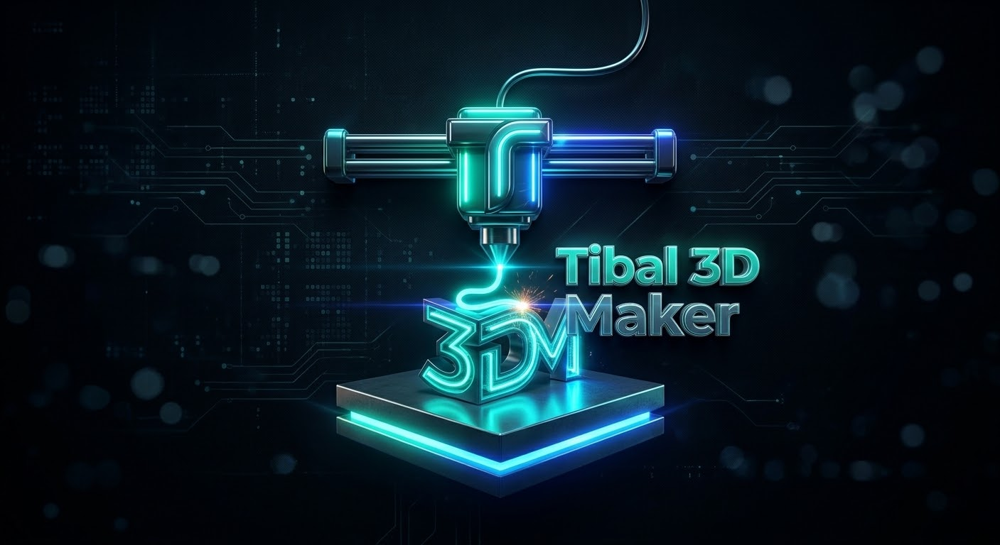

# Tibal 3D Maker

<div align="center">



### Conception CAO et impression 3D sur mesure

Du dessin 3D à la pièce imprimée : réparations, adaptations, prototypes et créations personnalisées.

[Découvrir le site](https://tibal76.github.io/tibal-3d-maker) · [Demander un devis](mailto:tibal76@proton.me) · [Suivre sur TikTok](https://www.tiktok.com/@tibal.3d.maker)


</div>

---

## À propos

Ancien ajusteur aéronautique, j'ai changé de voie pour construire une activité tournée vers la création, la réparation et la fabrication sur mesure.

Cette expérience m'a appris à comprendre les contraintes techniques, travailler avec précision et trouver des solutions adaptées à chaque besoin. Aujourd'hui, j'utilise cette rigueur pour concevoir des pièces pratiques, remplacer des éléments introuvables et transformer une idée en objet réel.

**Tibal 3D Maker**, c'est une approche simple : observer le problème, modéliser la solution, puis fabriquer une pièce adaptée.

---

## Expertises

| Conception | Fabrication | Accompagnement |
|---|---|---|
| Modélisation CAO sur mesure | Impression 3D | Conseil technique |
| Pièces techniques | Prototypes fonctionnels | Étude des dimensions |
| Adaptations et assemblages | Pièces de remplacement | Recherche de solutions |
| Objets personnalisés | Petites séries | Accompagnement du projet |

---

## De l'idée à la pièce

```text
Besoin ou problème
        |
        v
Mesures, croquis ou pièce existante
        |
        v
Modélisation sur Fusion 360
        |
        v
Préparation et impression
        |
        v
Pièce finie, testée et prête à l'emploi
```

---

## Réalisations

### Support déporté pour sèche-serviettes

Adaptation sur mesure conçue pour répondre à un besoin précis d'écartement ou de fixation.

### Présentoir DVD

Organisation pratique d'une collection avec une fabrication adaptée à l'espace disponible.

### Cadre lithophane

Cadre personnalisé mettant en relief une image grâce à la variation d'épaisseur du matériau.

> Le portfolio photographique est progressivement complété sur le [site de Tibal 3D Maker](https://tibal76.github.io/tibal-3d-maker).

---

## Matériel et outils

- **CAO :** Fusion 360
- **Imprimantes :** Bambu Lab A1 et Bambu Lab P2S
- **Fabrication :** pièces fonctionnelles, prototypes, accessoires, objets personnalisés
- **Matières :** différents types de filaments selon la résistance, l'esthétique et l'utilisation prévue

---

## Zone d'intervention

Basé à **Saint-Pierre-lès-Elbeuf**, Tibal 3D Maker intervient principalement dans un rayon d'environ **30 km**.

Les projets peuvent également être étudiés à distance selon leur nature.

---

## Démarrer un projet

Pour obtenir une estimation, transmettez :

- Une description ou une photo du besoin
- Les dimensions utiles
- Votre contrainte principale : réparation, adaptation, esthétique ou résistance
- Une date souhaitée, si elle est importante

<div align="center">

### Vous avez une idée ou une pièce à remplacer ?

[**Demander un devis**](mailto:tibal76@proton.me)

</div>

---

## Projet technique

Ce dépôt contient le site vitrine de Tibal 3D Maker :

- HTML sémantique
- CSS responsive
- JavaScript vanilla
- Galerie filtrable
- Liens de contact centralisés dans [`js/script.js`](js/script.js)

<div align="center">

**Tibal 3D Maker** · Saint-Pierre-lès-Elbeuf · [Site](https://tibal76.github.io/tibal-3d-maker) · [TikTok](https://www.tiktok.com/@tibal.3d.maker) · [Email](mailto:tibal76@proton.me)

</div>