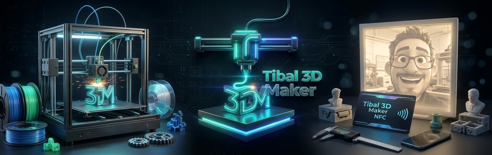
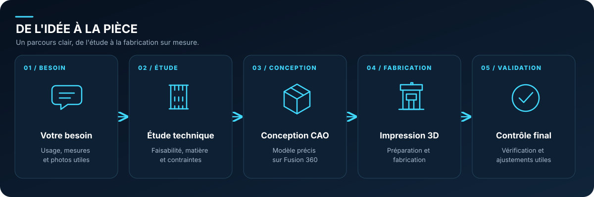

# Tibal 3D Maker

## Conception CAO et impression 3D sur mesure

Du besoin concret à la pièce fabriquée : réparations, adaptations, prototypes et créations personnalisées.

[Découvrir le site](https://tibal76.github.io/tibal-3d-maker/) · [Présenter un projet](mailto:tibal76@proton.me)

[Instagram](https://www.instagram.com/tibal.3d.maker/) · [Facebook](https://www.facebook.com/tibal.3d.maker/) · [TikTok](https://www.tiktok.com/@tibal.3d.maker)

---

## À propos

Mon parcours relie métiers manuels et techniques : aide-charpentier, formation en maintenance industrielle (bac pro MSMA), puis ajustage aéronautique. Aujourd'hui maroquinier, j'effectue aussi des missions en impression 3D pour développer des outils ergonomiques.

Ces expériences nourrissent une même approche : comprendre les contraintes d'un usage, travailler avec précision et concevoir des solutions adaptées. Avec Tibal 3D Maker, je mets cette polyvalence au service de pièces et d'objets sur mesure.

**Tibal 3D Maker**, c'est une approche simple : observer le besoin, étudier les contraintes, concevoir une solution puis fabriquer et contrôler une pièce adaptée.

## Expertises

| Conception | Fabrication | Accompagnement |
|---|---|---|
| Modélisation CAO sur mesure | Impression 3D | Conseil technique |
| Pièces techniques et fonctionnelles | Prototypes et pièces de remplacement | Étude des dimensions |
| Adaptations et assemblages | Petites séries | Recherche de solutions |
| Objets personnalisés | Réparations | Accompagnement du projet |

## De l'idée à la pièce

Chaque projet suit un parcours clair, adapté à son usage, ses dimensions et ses contraintes de fabrication.

  <picture>
    <source media="(max-width: 600px)" srcset="assets/readme/parcours-idee-piece-mobile.svg">
    
  </picture>

1. **Votre besoin** — préciser l'usage, le problème et les dimensions. Les photos et fichiers peuvent être échangés par e-mail après un premier contact.
2. **Étude technique** — évaluer la faisabilité, les matériaux et les contraintes.
3. **Conception CAO** — modéliser la solution sur Fusion 360 et la valider avant fabrication.
4. **Impression 3D** — préparer et fabriquer la pièce avec le matériau adapté.
5. **Contrôle final** — vérifier la pièce et ajuster la solution si nécessaire.

## Réalisations

### Supports de tringle pour sèche-serviettes

Paire de supports triangulaires en PETG conçus sur mesure. Ils accueillent une tringle en tube aluminium de 10 mm et favorisent le rayonnement de la chaleur ainsi que le séchage des serviettes.

### Présentoir DVD

Organisation pratique d'une collection avec une fabrication adaptée à l'espace disponible.

### Cadre lithophane

Cadre personnalisé qui révèle une image grâce aux variations d'épaisseur du matériau.

Le portfolio est visible dans la galerie filtrable du [site Tibal 3D Maker](https://tibal76.github.io/tibal-3d-maker/#realisations).

## Le site

Le site vitrine est conçu pour présenter l'activité et faciliter le premier contact. Il comprend :

- Une bannière panoramique dédiée aux ordinateurs et une version recadrée pour mobile
- Les sections expertises, réalisations, méthode, à propos et contact
- Une galerie filtrable par type de réalisation
- Des liens directs vers Instagram, Facebook et TikTok dans le menu, y compris sur mobile
- Un bouton de retour en haut de page qui apparaît pendant le défilement
- Un formulaire de demandes préliminaires transmis par FormSubmit ; les photos et fichiers sont échangés ensuite par e-mail
- Une activité en préparation : les demandes permettent de présenter un projet, mais aucune commande n’est acceptée pour le moment
- Une mise en page responsive, des repères de focus clavier et des éléments HTML sémantiques
- Des métadonnées pour le référencement et l'aperçu lors du partage du site
- Une année de copyright mise à jour automatiquement dans le pied de page
- Des pages d’informations légales et de confidentialité accessibles depuis le pied de page

## Matériel et outils

- **CAO :** Fusion 360
- **Imprimantes :** Bambu Lab A1 et Bambu Lab P2S
- **Fabrication :** pièces fonctionnelles, prototypes, accessoires, objets personnalisés et petites séries
- **Matières :** filaments choisis selon la résistance, l'esthétique et l'utilisation prévue

## Zone d'intervention

Basé à **Saint-Pierre-lès-Elbeuf**, Tibal 3D Maker intervient principalement dans un rayon d'environ **30 km**. Les projets peuvent également être étudiés à distance selon leur nature.

## Préparer un projet

Pour présenter un projet en amont du lancement, indique :

- Une description du besoin ou du problème à résoudre
- Les dimensions utiles et le contexte d'utilisation
- La contrainte principale : réparation, adaptation, esthétique ou résistance
- Une date souhaitée, si elle est importante

### Une idée ou une pièce à remplacer ?

[**Présenter un projet**](mailto:tibal76@proton.me)

## À propos du dépôt

Ce dépôt contient le site statique publié avec GitHub Pages :

- `index.html` — contenu, navigation et formulaire
- `css/style.css` — mise en page et styles responsive
- `js/script.js` — filtres, menu mobile, retour en haut et formulaire
- `assets/logo/` — logo et bannières ordinateur/mobile
- `assets/realizations/` — visuels des réalisations
- `assets/readme/` — infographie du parcours projet
- `mentions-legales.html` et `confidentialite.html` — informations du site et traitement des demandes

Le site utilise HTML, CSS et JavaScript natifs, sans framework ni étape de compilation. Les documents de gestion privés restent exclus du dépôt.

## Droits sur les contenus

Ce dépôt ne concède pas de licence de réutilisation des textes, visuels et créations originaux dont Thibault Julien détient les droits. Les marques, logos et éléments de tiers restent la propriété de leurs titulaires respectifs. Les informations légales publiées sur le site sont à actualiser si le statut de l’activité évolue.

**Tibal 3D Maker** · Saint-Pierre-lès-Elbeuf · [Site](https://tibal76.github.io/tibal-3d-maker/) · [E-mail](mailto:tibal76@proton.me)

